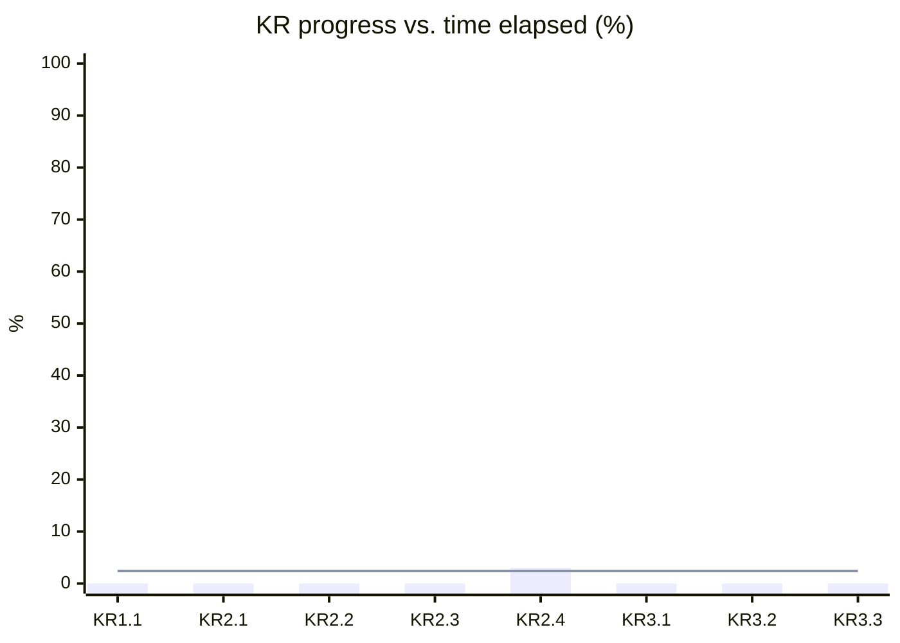
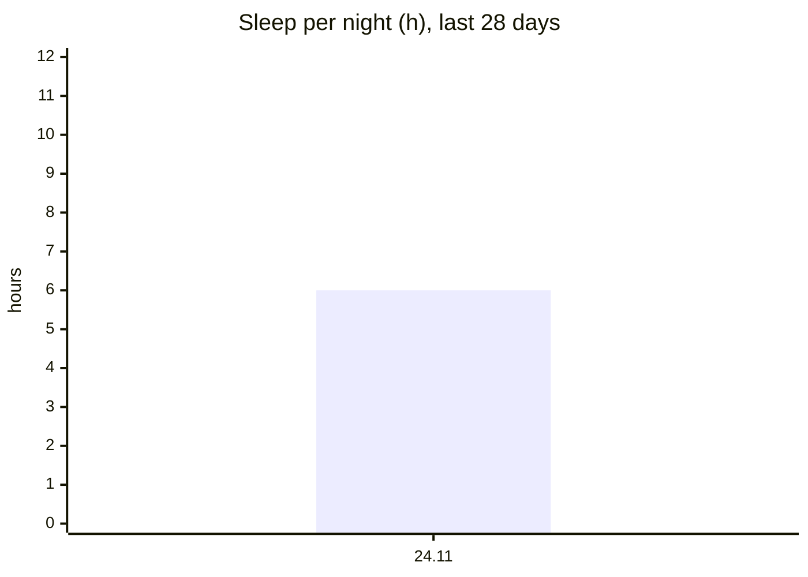
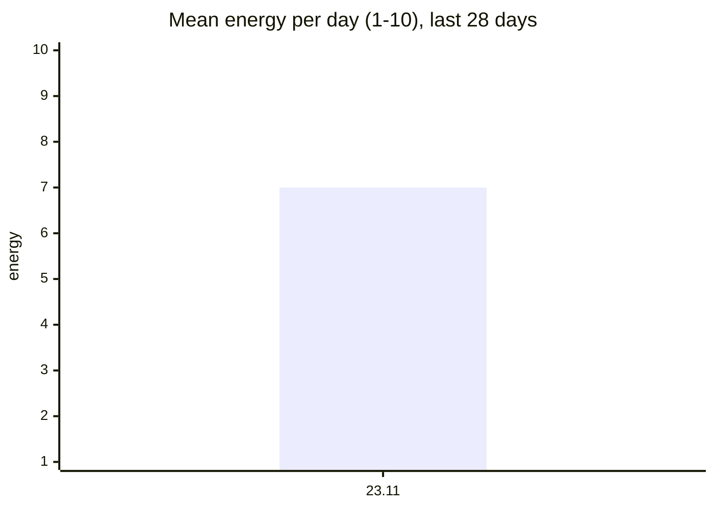
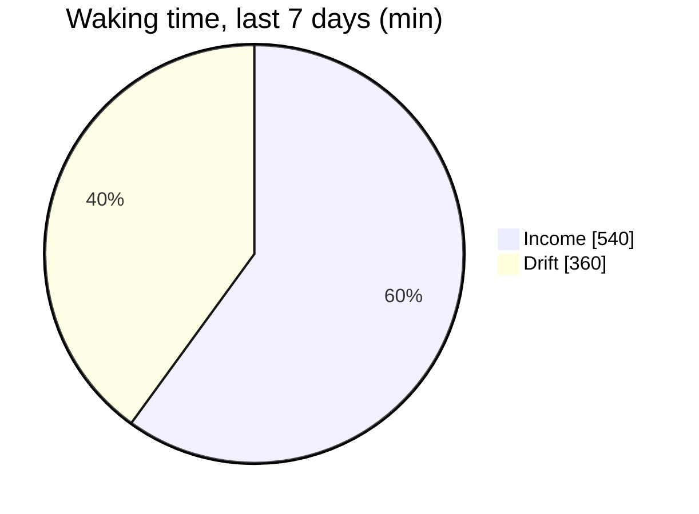

# Dashboard (Übersicht)

_Generated 2026-11-24 by `scripts/dashboard.py` · last sheet sync: 2026-11-24T14:20:15+01:00 · 3 entries in DB. Do not edit by hand; regenerated every review._

**Cycle 2026-C1** · 2026-11-23 → 2027-02-14
Week 1/12  `░░░░░░░░░░ 2%` elapsed

## OKR progress (Fortschritt)

### O1 Finish the master's (Phase 1) with no loose ends — _Masterabschluss ohne offene Enden_
Objective `░░░░░░░░░░ 0%` (mean of KRs with a defined target)

| KR | Key result | Progress | Value | Pace |
|---|---|---|---|---|
| KR1.1 | Study deep-work hours (thesis + exam prep) | `░░░░░░░░░░ 0%` | 0.0 / 180 h | ● on pace ⚑ TBD |
| KR1.2 | Open master's deliverables completed (exams passed / thesis milestones) | `░░░░░░░░░░ n/a` | 0 / TBD items |  ⚑ TBD |

### O2 Generate the evidence for the decision gate (quant vs. second master's vs. other) — _Entscheidungsgrundlage für das Decision Gate erzeugen_
Objective `░░░░░░░░░░ 1%` (mean of KRs with a defined target)

| KR | Key result | Progress | Value | Pace |
|---|---|---|---|---|
| KR2.1 | Quant exploration hours (study, projects, paper trading) | `░░░░░░░░░░ 0%` | 0.0 / 60 h | ● on pace ⚑ TBD |
| KR2.2 | Philosophy/psychology exploration hours (MAPP prep, reading, writing) | `░░░░░░░░░░ 0%` | 0.0 / 60 h | ● on pace ⚑ TBD |
| KR2.3 | Gate criteria fully specified (questionnaire answered, thresholds set) | `░░░░░░░░░░ 0%` | 0 / 1 done | ● on pace |
| KR2.4 | Days with a logged Logbuch entry (data quality is the evidence) | `░░░░░░░░░░ 3%` | 2 / 67 days | ● on pace |

### O3 Stabilise the base: German, sleep, review rhythm — _Fundament stabilisieren: Deutsch, Schlaf, Reviewrhythmus_
Objective `░░░░░░░░░░ 0%` (mean of KRs with a defined target)

| KR | Key result | Progress | Value | Pace |
|---|---|---|---|---|
| KR3.1 | Days with >= 20 min German | `░░░░░░░░░░ 0%` | 0 / 60 days | ● on pace |
| KR3.2 | Nights with >= 7 h sleep logged | `░░░░░░░░░░ 0%` | 0 / 60 nights | ● on pace ⚑ TBD |
| KR3.3 | Days with an evening review | `░░░░░░░░░░ 0%` | 0 / 70 days | ● on pace |


_Bars = % achieved; line = % of the cycle elapsed. A bar below the line is behind pace. KRs with target TBD are left out._

## Habit streaks (Serien)

| Habit | Streak now | Best | 7 d | 28 d |
|---|---|---|---|---|
| Wake anchor (Weckanker) | 0 d | 0 d | `░░░░░░░ 0%` 0/7 | 0/28 |
| Deep block 90 min (Tiefenarbeit) | 0 d | 0 d | `░░░░░░░ 0%` 0/7 | 0/28 |
| German 20 min (Deutsch) | 0 d | 0 d | `░░░░░░░ 0%` 0/7 | 0/28 |
| Evening review (Abendreview) | 0 d | 0 d | `░░░░░░░ 0%` 0/7 | 0/28 |

Last 28 days, one square per day (weeks start at the date shown):

```text
                   28.10   04.11   11.11   18.11  
Wake anchor        ┄┄┄┄┄┄┄ ┄┄┄┄┄┄┄ ┄┄┄┄┄┄┄ ┄┄┄┄┄□□
Deep block 90 min  ┄┄┄┄┄┄┄ ┄┄┄┄┄┄┄ ┄┄┄┄┄┄┄ ┄┄┄┄┄□□
German 20 min      ┄┄┄┄┄┄┄ ┄┄┄┄┄┄┄ ┄┄┄┄┄┄┄ ┄┄┄┄┄□□
Evening review     ┄┄┄┄┄┄┄ ┄┄┄┄┄┄┄ ┄┄┄┄┄┄┄ ┄┄┄┄┄□□
                   ■ done  □ missed  ┄ nothing logged that day
```

## Sleep & energy, last 14 days (Schlaf & Energie)

- Energy (1–10): `············▆·`  7-d avg 7.0 (prev n/a)
- Sleep (h):     `·············▃`  7-d avg 6.0 (prev n/a)
- Sleep↔energy correlation: need ≥7 days with both (have 0).


_Line = 7 h target. Only days with data are shown (1 of 28)._


_Only days with data are shown (1 of 28)._

## Goal work vs. drift (Zielarbeit vs. Abdriften)

Share of logged waking minutes (sleep excluded). Only as honest as logging coverage.

| Window | Goal | Income | Maint. | Rest | **Drift** | Unclass. | Logged h/day |
|---|---|---|---|---|---|---|---|
| Last 7 d | 0% | 60% | 0% | 0% | **40%** | 0% | 7.5 |
| Cycle | 0% | 60% | 0% | 0% | **40%** | 0% | 7.5 |

Last 7 d: Goal work `░░░░░░░░░░ 0%`

Top drift (7 d): doom scrolling 360 min



```mermaid
xychart-beta
    title "Goal vs. drift per cycle week (%)"
    x-axis ["W1"]
    y-axis "%" 0 --> 100
    bar [0]
    line [40]
```
_Bars = goal-work share; line = drift share of logged waking time._

_Legend: goal = moves the roadmap · income = paid work · maint. = body/admin · rest = deliberate recovery · drift = unintended loss. Mapping in `config/categories.json`._

## Decision gate (Entscheidungstor)

Energy comes from your logs this cycle; feasibility is scored at `/intake` or `/quarterly` (criteria in `roadmap/life-map.md` §3, inputs in `roadmap/gate.json`). A path is plotted only when both exist.

| Path | Energy categories | Mean energy (n) | Feasibility | On chart |
|---|---|---|---|---|
| Q Quant | Quant | n/a (0) | TBD | no: feasibility not scored, needs 5 ratings |
| M Second master | Philosophy | n/a (0) | TBD | no: feasibility not scored, needs 5 ratings |
| O Other | Freelance, Career | n/a (0) | TBD | no: feasibility not scored, needs 5 ratings |
| Baseline | all rated blocks | 7.0 (1) | – | – |

_No path can be plotted yet. The chart appears once a path has enough energy ratings and a feasibility score._

_Self-rated energy is noisy and favours whatever is new; read it next to hours logged and output produced._
