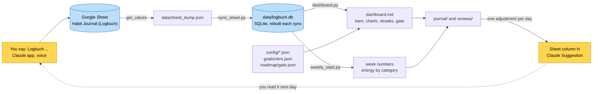
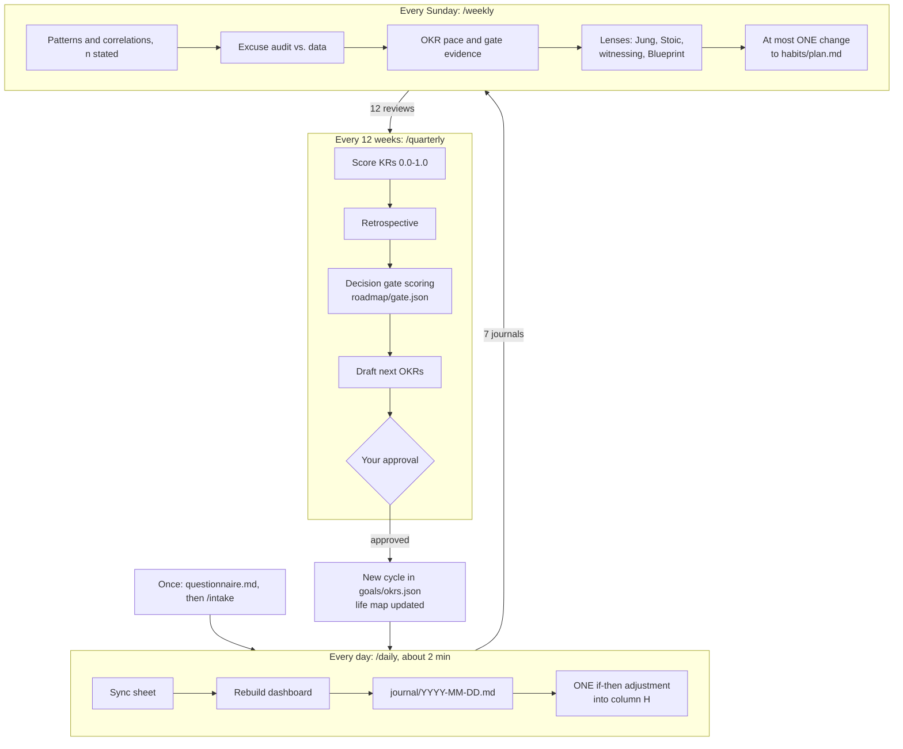

# How Logbuch works (Systemübersicht)

Two diagrams: where the data goes, and which review loop runs when. Both render on GitHub.

## 1. Data flow (Datenfluss)

The sheet is the source of truth. The database is rebuilt from it on every sync; nothing in `data/` is committed.
The only cell Claude writes in the sheet without being asked is column H of the day's last row.

## 2. Review loops (Rückblick-Rhythmus)

## 3. Where to look

| Question | Open | What you see |
|---|---|---|
| Am I on track this cycle? | `dashboard.md` → OKR progress | Bars per KR, pace flags, bar chart vs. time elapsed |
| Are my habits holding? | `dashboard.md` → Habit streaks | Streak table and a 28-day grid (■ done, □ missed, ┄ not logged) |
| How am I sleeping and feeling? | `dashboard.md` → Sleep & energy | Sleep bars against the 7 h line; daily energy line |
| Where does my time go? | `dashboard.md` → Goal work vs. drift | Pie for the last 7 days; goal vs. drift share per cycle week |
| Which career path is winning? | `dashboard.md` → Decision gate | Energy per path from your logs; quadrant chart once feasibility is scored |
| What's the 3-year plan? | `roadmap/life-map.md` | Flowchart of paths and the gate; Gantt timeline with today marked |
| What happened on a given day/week? | `journal/`, `reviews/` | Numbers, observations, the adjustment and its outcome |

Best viewer: the repo on github.com or the GitHub mobile app (both render Mermaid). Plain text editors show the chart code instead.
