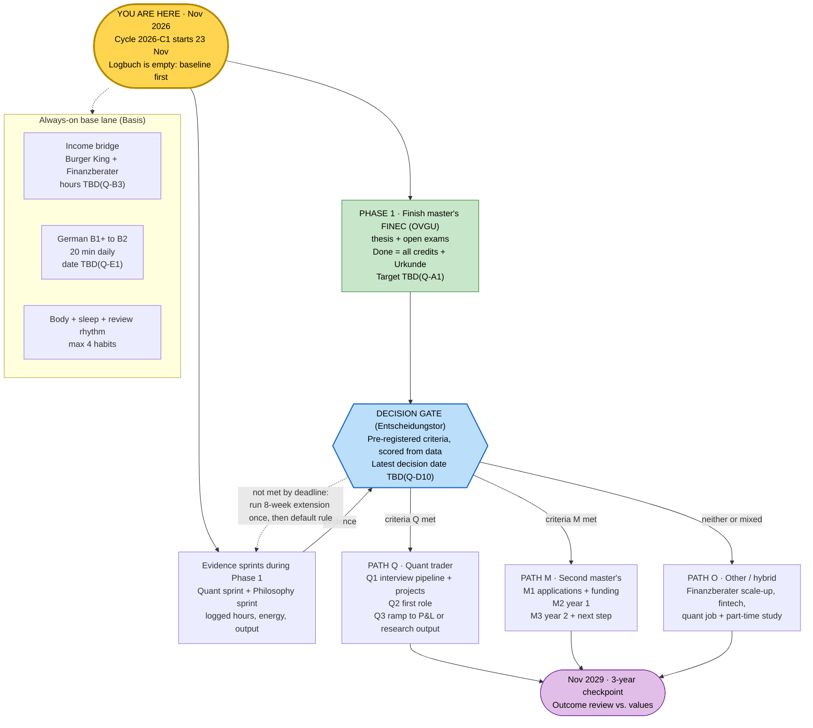
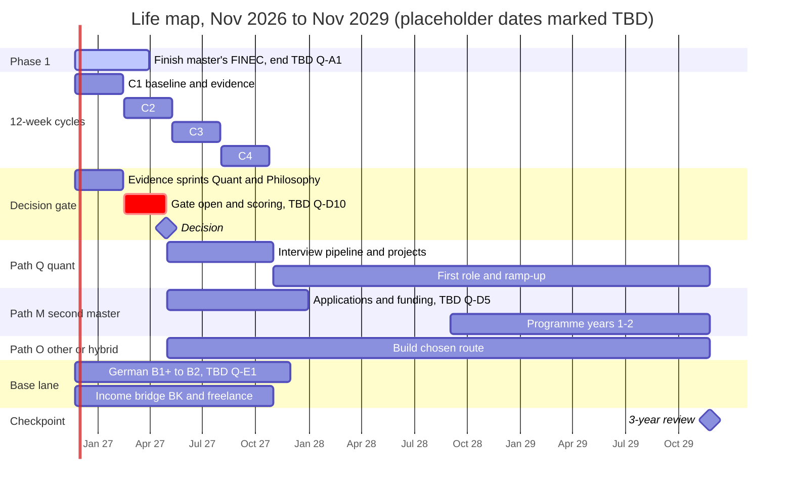

# Life Map (Lebenslandkarte): Nov 2026 → Nov 2029

**Status: DRAFT v0 for Bipul's approval.** Built before the questionnaire; every date or threshold marked `TBD(Q-…)`
is a placeholder, not a fact. Re-rendered by `/quarterly`.

## 1. Flowchart

**You are here:** Phase 1, week 1 of cycle 2026-C1 (first entry logged 2026-11-23). Evidence sprints and the base lane run in parallel with the master's,
bounded by the weekly-hours budget (capacity check pending `TBD(Q-C6)`; Phase 1 gets priority).

### 1b. Timeline (Zeitachse)

The red line is today (GitHub draws it automatically). **Every end date except cycle C1 is a placeholder** until the
questionnaire is answered; the bars show order and rough length, not commitments. Only one of the three paths will run.

> ⚠ **Check this when D5 is answered:** if a second master's programme's application deadline falls *before* the gate
> decision (Apr 2027 placeholder), the gate has to move earlier, or the application is sent as a cheap option without a final decision.
> Programme application deadlines are often months before the start date.

## 2. Phase 1: Finish the master's (Masterabschluss)
- **Exit criteria:** all credit points earned; thesis submitted and graded; Zeugnis/Urkunde requested.
- **Known open items:** BAM mock-exam window and AIbDS II Q&A appear in the planner app; full list `TBD(Q-A2)`.
- **Rule:** Phase 1 deliverables outrank exploration hours. If KR1.x is behind pace two weeks running, exploration
  sprints (KR2.1, KR2.2) are paused first, not the thesis.
- **Why it is a gate input too:** final grade and thesis topic affect both the quant and MAPP paths `TBD(Q-A4)`.

## 3. Decision Gate (Entscheidungstor)

### 3.1 Protocol
1. **Open** at thesis submission, or at the first `/quarterly` after the evidence minimum is met, whichever is first.
2. **Pre-register** weights and thresholds before looking at results (done during `/intake` + first `/quarterly`).
   Placeholder weights below sum to 100 and are overwritten by `TBD(Q-D1)`.
3. **Score** each path 0-5 per criterion with the evidence column; weighted total; record in `reviews/`.
4. **Decide** by the latest decision date `TBD(Q-D10)`. A path wins if it leads by ≥ 10 weighted points **and** passes
   its hard gates. Otherwise run one 8-week extension aimed at the weakest evidence, then default to the
   most reversible path (see 3.5).
5. **Regret check (Stoic + Jung):** write down what you fear losing on each rejected path and who you are in
   each story. Decisions made to flee something (shadow) are flagged, not forbidden.
6. Any change to criteria after seeing data needs a written reason and your approval.

### 3.2 Path Q: Quant trader
| Criterion (weight, placeholder) | Evidence needed | Source / how measured |
|---|---|---|
| Fit of skills (20) | Python/C++/SQL and probability/stats level vs. typical entry bars; 2+ finished projects | Self-test, GitHub, mock interviews `TBD(Q-D3)` |
| Market access (15) | ≥ N interviews or referrals in a defined window; list of target firms and their requirements | Applications tracker (`Career` category), recruiter feedback |
| Energy/flow (20) | Mean Mood/Energy and subjective flow during `Quant` blocks vs. baseline; willingness to repeat (hours logged without prompting) | Logbuch: `weekly_stats.py` → `cycle_by_category` |
| Economics (15) | Realistic compensation range vs. runway needs and Germany cost of living | Offers, salary data `TBD(Q-C1)` |
| Values fit (20) | Does the daily reality serve your top values (mastery, freedom...)? Compare to worst-week description | `TBD(Q-D1, Q-D4)` |
| Reversibility (10) | Cost of exit after 2 years | Judgement + base rates |
- **Hard gates (all must pass):** (a) ≥ 1 credible route to interviews exists; (b) energy during Quant blocks is not
  below your overall mean by > 1 point after 6+ weeks of logged data; (c) runway covers the search period.

### 3.3 Path M: Second master's (Mundus MAPP or equivalent)
> ⚠ **Verify the programme.** My recollection is that "Mundus MAPP" is the Erasmus Mundus Master in *Public Policy*,
> not philosophy/psychology. If you want a philosophy/psychology master's, the real candidates differ. `TBD(Q-D5)`.

| Criterion (weight, placeholder) | Evidence needed | Source |
|---|---|---|
| Admissibility (20) | Entry requirements met; admission-rate base rate; deadline and application effort | Programme pages, `TBD(Q-D5)` |
| Funding (20) | Scholarship or loan plan covering tuition and living costs | Funding calls, `TBD(Q-C1)` |
| Energy/flow (20) | Mean energy and unprompted hours in `Philosophy` blocks vs. baseline; output produced (essays, notes) | Logbuch |
| Career pathway (15) | Concrete 5-year route after the degree: roles, employers, income | Alumni/job postings research |
| Values fit (15) | Is this *toward* meaning, not *away* from pressure? Shadow check passed | `TBD(Q-D6)` |
| Reversibility (10) | Cost of 1-2 more student years vs. option value | Judgement |
- **Hard gates:** (a) admission plausible (not a lottery ticket you can't afford); (b) funding plan exists;
  (c) `Philosophy` hours are logged voluntarily for ≥ 6 weeks.

### 3.4 Path O: Other / hybrid
Candidates `TBD(Q-D7)`: scale Finanzberater work, fintech/risk/data roles, quant-adjacent roles with part-time
study, PhD. Same scoring grid; weights from `TBD(Q-D1)`. Path O is also the **default if neither Q nor M clears its gates.**

### 3.5 Default rule if undecided at the deadline
Take the path with the highest *reversibility* that still keeps income and German progress intact, and schedule the next
gate review (3-6 months). Indecision itself is logged as an avoidance pattern for the weekly shadow review.

## 4. Evidence the Logbuch must produce (data plan)
| Question | Metric | Min. data before it counts |
|---|---|---|
| Which work gives me energy? | Mean Mood/Energy by category (`cycle_by_category`) | ≥ 15 rated blocks per category over ≥ 4 weeks |
| What do I do unprompted? | Hours per week in `Quant` vs. `Philosophy` in weeks without a deadline | ≥ 4 weeks |
| Is the energy real or novelty? | Trend of energy per category: week 1-2 vs. weeks 5-6 | ≥ 6 weeks |
| Do I execute? | KR2.1/KR2.2 progress, outputs (projects, essays, applications) | Cycle end |
| Am I a reliable witness? | Logged days (KR2.4) and hours/day coverage | ≥ 80% days logged |
- **Caveat:** self-rated energy is noisy and biased toward what is new. Treat as one input among several, not as the verdict.

## 5. Base lane (Basis) and 3-year horizon
- **Income bridge:** keep BK/freelance hours within budget `TBD(Q-B3)`; income must cover costs until the path starts.
- **German:** B1+ → B2 `TBD(Q-E1)`. Matters for all paths in Germany, and for MAPP-style programmes as a language credential.
- **Body:** sleep regularity first; nothing else until the wake anchor is stable.
- **Nov 2029 checkpoint:** review against the values in `CLAUDE.md` §2, not only against income or title.

## 6. Open questions blocking a firmer map
See `questionnaire.md` items A1, A2, C1, D1, D3, D5, D7, D9, D10. Until answered, dates and weights above stay provisional.
